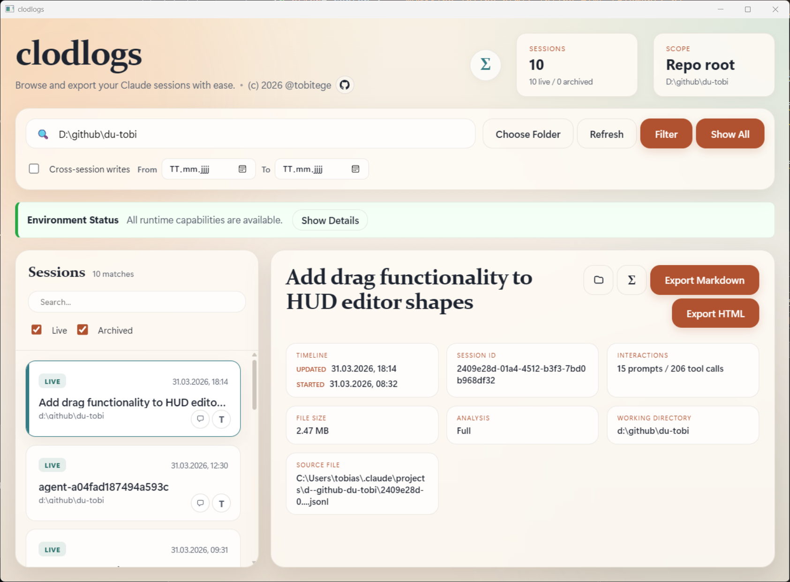
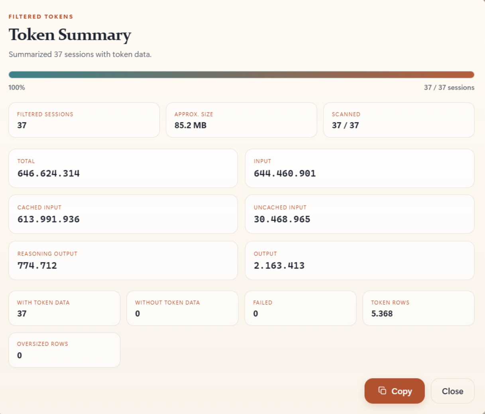

<p align="center">
  
</p>

<p align="center">
  
  
  
  
</p>

# clodlogs

`clodlogs` is a native Avalonia desktop app for browsing, replaying, analyzing, sanitizing, and exporting Claude Code session logs.

This is a port of my Codex logs tool "[codlogs](https://github.com/tobitege/codlogs)" with the same feature set, thus a low commit count for now.

Claude Code stores project logs under:

```text
%USERPROFILE%\.claude\projects\<sanitized-project-path>\*.jsonl
```

For example:

```text
C:\Users\[username]\.claude\projects\c--github-myrepo
```

<p align="center">
  
</p>

<p align="center">
  
</p>

## Desktop App

The desktop app uses [Avalonia](https://avaloniaui.net/) and targets .NET 10.

Prerequisites:

- Windows 10 or later
- .NET 10 SDK for local development
- Avalonia 12.1

Run it locally:

```powershell
dotnet run --project src\Clodlogs.Desktop\Clodlogs.Desktop.csproj
```

Other useful commands:

```powershell
dotnet build Clodlogs.sln -c Release
dotnet run --project src\Clodlogs.Desktop.Tests\Clodlogs.Desktop.Tests.csproj -c Release
dotnet publish src\Clodlogs.Desktop\Clodlogs.Desktop.csproj -c Release -r win-x64 --self-contained true -p:PublishSingleFile=true -p:PublishTrimmed=false
```

Current desktop app highlights:

- scans Claude project JSONL logs from `~/.claude/projects` or `%CLAUDE_HOME%\projects`
- filters by current folder tree or repo root and can include cross-session writes
- exports selected sessions to Markdown, HTML or an OpenCode 2 session file
- batch exports filtered sessions with collision-safe file naming
- summarizes Claude message usage for one selected session or all currently filtered sessions
- shows environment status for Claude home access, `git`, and `rg`
- opens a read-only full-window session replay dialog
- creates sanitized session copies with optional image and blob removal

## Large Session Handling

clodlogs is built to stay usable when a Claude session file becomes very large.

Current behavior:

- probes session file size without loading the whole file into memory
- uses bounded JSONL scanning for browsing and detail inspection
- scans session files on several threads and reports the progress in the status line
- skips automatic deep analysis for very large sessions to keep the UI responsive
- offers `Analyze Anyway` for a bounded manual scan when automatic analysis is skipped
- treats oversized JSONL rows as partial-analysis conditions instead of crashing normal inspection
- streams Markdown, HTML and OpenCode export so large session files do not require whole-file reads during export

## OpenCode Session Export

clodlogs can write a Claude session as a session file for [OpenCode](https://opencode.ai/) 2, so the conversation can be read and continued there. Choose `opencode` as the format in the export dialog or in the batch export. The file is named `<session>.opencode.json`.

Import the file in OpenCode in one of two ways:

- In the OpenCode desktop app: in the sidebar under `Projects`, open the `⋯` menu (`More options`) of the project the session should belong to, choose `Import session` and pick the file.
- On the command line: `opencode session import <file> --directory <project folder>`. OpenCode attaches the session to the project of `--directory`, or of the current folder without it. With only the desktop app installed, `opencode` is not on the PATH; on Windows its command line program is `%LOCALAPPDATA%\Programs\ai.opencode.desktop\resources\opencode-cli.exe`.

What the file contains:

- each prompt as a user message; with `Include images`, its images are embedded as attachments
- each model response as an assistant message with its thinking and text, under the Claude model name and the provider `anthropic`, with its token counts
- with `Include tool calls and tool outputs`, each tool call with its input and result; a failed call keeps its error, and a call without a recorded result is marked as failed
- an idle marker at the end of each turn, with the outcome `succeeded`, `failed` or `interrupted`
- text that Claude Code added for the model, such as command caveats, as a synthetic message
- a compaction summary where Claude Code compacted the conversation
- the session title (the custom title, else the generated title, else the first prompt), the start time and the token totals

Notes:

- include tool calls and tool outputs when the session is meant to be continued; without them OpenCode sees only the prompts and answers
- only images embedded in the session are exported; image links are skipped
- subagent rows and the API request rows of Claude Code are not part of the conversation and are left out
- the session and message identifiers are derived from the Claude session, so importing the same session again reports `Session already exists`; delete the imported session in OpenCode first to import a newer export
- Claude Code tool names such as `Bash` or `Edit` are kept as they are; OpenCode shows these calls but has no tools of the same name
- OpenCode reads the whole file into memory during the import, so a session with many images needs correspondingly more memory there
- the format follows `opencode session export` of OpenCode 2.3 and was tested against `opencode session import` of that version

## Changelog

### 1.0.3

- Added the native Avalonia Windows desktop app for browsing, replaying, analyzing, sanitizing, and exporting Claude sessions.
- Added collision-safe Markdown and HTML batch export for selected sessions from the filtered list.
- Added responsive, cancellable startup scanning with partial results and explicit completion status.
- Updated the Avalonia desktop packages to 12.1.1.

### 1.0.4

- Expanded token analysis with input, output, cache write, cache read, total-token, daily-usage, model, and estimated-cost breakdowns.
- Added refreshable Anthropic model pricing with separate 5-minute and 1-hour cache-write rates.
- Added PNG, CSV, and Markdown exports for token statistics.

### 1.0.5

- Fixed the tool-call option in HTML and Markdown exports, including batch exports, and removed duplicate tool and thinking content.
- Preserved Claude content block order and added support for plain-text messages and native Claude images, including images in tool results.
- Protected existing export files from failed or cancelled replacements and added collision-safe names for automatic single-session exports.
- Kept batch exports running after individual filename reservation failures and rejected unsupported export formats.
- Reported image write failures and fixed image asset collisions and links containing spaces or special characters.
- Updated the Avalonia desktop packages to 12.1.2.

### 1.0.6

- Updated HarfBuzzSharp to 14.2.1.300, SkiaSharp to 4.153.0, and Tmds.DBus.Protocol to 0.95.1, including matching native packages.

### 1.0.7 - 2026-10-23

- Updated HarfBuzzSharp and its native packages to 14.2.1.301.
- Updated SkiaSharp and its native packages to 4.153.1.

### 1.0.8 - 2026-11-09

- Updated the Avalonia desktop packages to 12.1.6.
- Updated HarfBuzzSharp and its native packages to 14.4.0.
- Updated SkiaSharp and its native packages to 4.155.0.
- Updated Tmds.DBus.Protocol to 0.95.2.

### 1.1.0 - 2026-11-17

- Added the export format `opencode`, which writes a session file for `opencode session import` of OpenCode 2. It is available in the single and the batch export, and the options for images and for tool calls apply.
- Fixed the session replay, the Markdown and HTML exports and the tool-call count treating the API request rows of Claude Code as conversation. They showed the system prompt and repeated messages, and counted tool calls twice.
- Fixed `Refresh`, `Browse Folder` and `All Sessions` showing no progress during the scan. The status line now counts the scanned files and found sessions, the progress bar shows the share of files read, and a stale partial-results notice is removed when the scan starts.
- Session files are now scanned on several threads. A history of about 1,100 files (6.6 GB) loads in about 7 seconds instead of about a minute.
- Fixed the session list showing the session id for a session that the user named. A title set by the user now wins over the generated title.
- Fixed the prompt count leaving out prompts that Claude Code stores as plain text, which showed `0 prompts` for such sessions.
