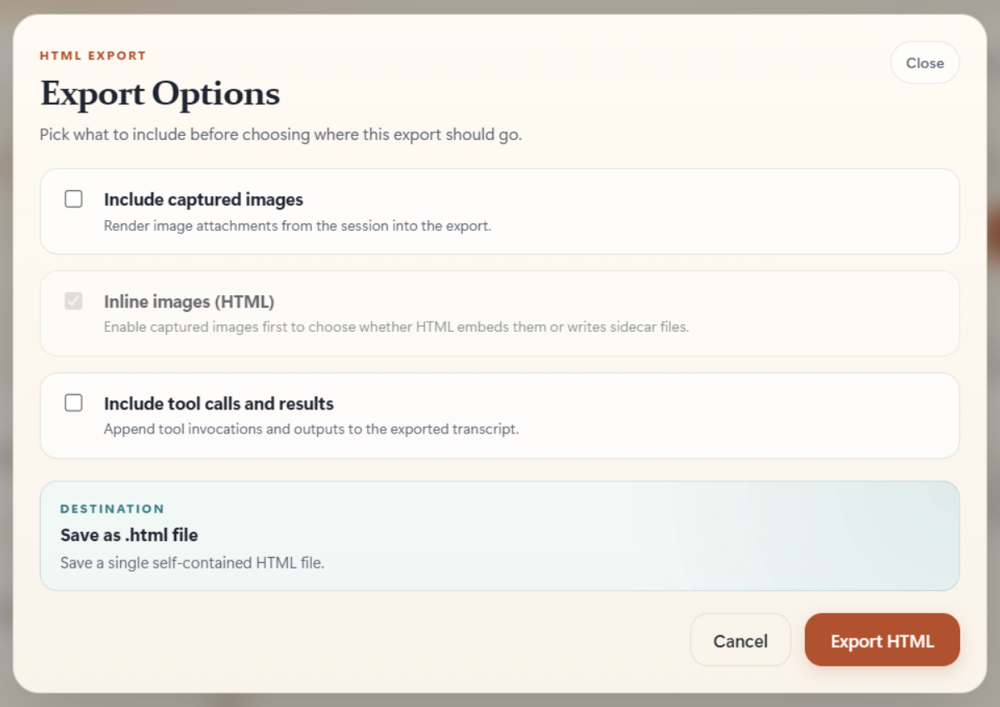

<p align="center">
  
</p>

<p align="center">
  
  
  
  
</p>

# clodlogs

`clodlogs` is a native Avalonia desktop app for browsing, replaying, analyzing, sanitizing, and exporting Claude Code session logs.

This is a port of my Codex logs tool "[codlogs](https://github.com/tobitege/codlogs)" with the same feature set, thus a low commit count for now.

Claude Code stores project logs under:

```text
%USERPROFILE%\.claude\projects\<sanitized-project-path>\*.jsonl
```

For example:

```text
C:\Users\[username]\.claude\projects\c--github-myrepo
```

<p align="center">
  
</p>

<p align="center">
  
</p>

## Desktop App

The desktop app uses [Avalonia](https://avaloniaui.net/) and targets .NET 10.

Prerequisites:

- Windows 10 or later
- .NET 10 SDK for local development
- Avalonia 12.1

Run it locally:

```powershell
dotnet run --project src\Clodlogs.Desktop\Clodlogs.Desktop.csproj
```

Other useful commands:

```powershell
dotnet build Clodlogs.sln -c Release
dotnet run --project src\Clodlogs.Desktop.Tests\Clodlogs.Desktop.Tests.csproj -c Release
dotnet publish src\Clodlogs.Desktop\Clodlogs.Desktop.csproj -c Release -r win-x64 --self-contained true -p:PublishSingleFile=true -p:PublishTrimmed=false
```

Current desktop app highlights:

- scans Claude project JSONL logs from `~/.claude/projects` or `%CLAUDE_HOME%\projects`
- filters by current folder tree or repo root and can include cross-session writes
- exports selected sessions to Markdown, HTML or an OpenCode 2 session file, with options for images, tool calls and thinking
- batch exports filtered sessions with collision-safe file naming
- summarizes Claude message usage for one selected session or all currently filtered sessions
- shows environment status for Claude home access, `git`, and `rg`
- opens a read-only full-window session replay dialog
- creates sanitized session copies with optional image and blob removal
- lists and exports sessions from the command line, filtered by session, project, time window and title

## Large Session Handling

clodlogs is built to stay usable when a Claude session file becomes very large.

Current behavior:

- probes session file size without loading the whole file into memory
- uses bounded JSONL scanning for browsing and detail inspection
- scans session files on several threads and reports the progress in the status line
- skips automatic deep analysis for very large sessions to keep the UI responsive
- offers `Analyze Anyway` for a bounded manual scan when automatic analysis is skipped
- treats oversized JSONL rows as partial-analysis conditions instead of crashing normal inspection
- streams Markdown, HTML and OpenCode export so large session files do not require whole-file reads during export

## OpenCode Session Export

clodlogs can write a Claude session as a session file for [OpenCode](https://opencode.ai/) 2, so the conversation can be read and continued there. Choose `opencode` as the format in the export dialog or in the batch export. The file is named `<session>.opencode.json`.

Import the file in OpenCode in one of two ways:

- In the OpenCode desktop app: in the sidebar under `Projects`, open the `⋯` menu (`More options`) of the project the session should belong to, choose `Import session` and pick the file.
- On the command line: `opencode session import <file> --directory <project folder>`. OpenCode attaches the session to the project of `--directory`, or of the current folder without it. With only the desktop app installed, `opencode` is not on the PATH; on Windows its command line program is `%LOCALAPPDATA%\Programs\ai.opencode.desktop\resources\opencode-cli.exe`.

What the file contains:

- each prompt as a user message; with `Include images`, its images are embedded as attachments
- each model response as an assistant message with its text, under the Claude model name and the provider `anthropic`, with its token counts; with `Include thinking`, also its thinking
- with `Include tool calls and tool outputs`, each tool call with its input and result; a failed call keeps its error, and a call without a recorded result is marked as failed
- an idle marker at the end of each turn, with the outcome `succeeded`, `failed` or `interrupted`
- text that Claude Code or the host added for the model, such as a reminder, a re-sent loop prompt, hook feedback or a host event, as a synthetic message; a reminder in front of a typed prompt is split off from the prompt
- a slash command of the user as it was typed, for example `/loop 10m check the build`
- a compaction summary where Claude Code compacted the conversation
- the session title (the custom title, else the generated title, else the first prompt), the start time and the token totals

Some text only makes sense together with the tool calls and follows the option `Include tool calls and tool outputs`. With the option it is written as a synthetic message; without the option it is left out:

- a notification about a finished background task and a message from another session or a subagent
- the text of a loaded skill and the expansion of a slash command
- the note about the scale of a screenshot (`[Image: original 2082x1504, displayed at ...]`)

Rows that only served Claude Code's own interface are always left out:

- the marker `[Request interrupted by user]`; the idle marker of the turn has the outcome `interrupted`
- commands that Claude Code ran itself, such as `/model` or `/compact`, with their caveat and their output
- the placeholder answer `No response requested.`
- the message of a failed API request, such as a usage limit or an overloaded server; the turn has the outcome `failed`
- the note with the temporary path of a pasted image, the resume marker `Continue from where you left off.` and the list of tools used before a compaction

Notes:

- the references that the tool search returns are written as one line, `Loaded tools: A, B`
- include tool calls and tool outputs when the session is meant to be continued; without them OpenCode sees only the prompts and answers
- only images embedded in the session are exported; image links are skipped
- subagent rows and the API request rows of Claude Code are not part of the conversation and are left out
- the session and message identifiers are derived from the Claude session, so importing the same session again reports `Session already exists`; delete the imported session in OpenCode first to import a newer export
- Claude Code tool names such as `Bash` or `Edit` are kept as they are; OpenCode shows these calls but has no tools of the same name
- OpenCode reads the whole file into memory during the import, so a session with many images needs correspondingly more memory there
- the format follows `opencode session export` of OpenCode 2.3 and was tested against `opencode session import` of that version

## Changelog

### 1.0.3

- Added the native Avalonia Windows desktop app for browsing, replaying, analyzing, sanitizing, and exporting Claude sessions.
- Added collision-safe Markdown and HTML batch export for selected sessions from the filtered list.
- Added responsive, cancellable startup scanning with partial results and explicit completion status.
- Updated the Avalonia desktop packages to 12.1.1.

### 1.0.4

- Expanded token analysis with input, output, cache write, cache read, total-token, daily-usage, model, and estimated-cost breakdowns.
- Added refreshable Anthropic model pricing with separate 5-minute and 1-hour cache-write rates.
- Added PNG, CSV, and Markdown exports for token statistics.

### 1.0.5

- Fixed the tool-call option in HTML and Markdown exports, including batch exports, and removed duplicate tool and thinking content.
- Preserved Claude content block order and added support for plain-text messages and native Claude images, including images in tool results.
- Protected existing export files from failed or cancelled replacements and added collision-safe names for automatic single-session exports.
- Kept batch exports running after individual filename reservation failures and rejected unsupported export formats.
- Reported image write failures and fixed image asset collisions and links containing spaces or special characters.
- Updated the Avalonia desktop packages to 12.1.2.

### 1.0.6

- Updated HarfBuzzSharp to 14.2.1.300, SkiaSharp to 4.153.0, and Tmds.DBus.Protocol to 0.95.1, including matching native packages.

### 1.0.7 - 2026-10-23

- Updated HarfBuzzSharp and its native packages to 14.2.1.301.
- Updated SkiaSharp and its native packages to 4.153.1.

### 1.0.8 - 2026-11-09

- Updated the Avalonia desktop packages to 12.1.6.
- Updated HarfBuzzSharp and its native packages to 14.4.0.
- Updated SkiaSharp and its native packages to 4.155.0.
- Updated Tmds.DBus.Protocol to 0.95.2.

### 1.1.0 - 2026-11-17

- Added the export format `opencode`, which writes a session file for `opencode session import` of OpenCode 2. It is available in the single and the batch export, and the options for images and for tool calls apply.
- Fixed the session replay, the Markdown and HTML exports and the tool-call count treating the API request rows of Claude Code as conversation. They showed the system prompt and repeated messages, and counted tool calls twice.
- Fixed `Refresh`, `Browse Folder` and `All Sessions` showing no progress during the scan. The status line now counts the scanned files and found sessions, the progress bar shows the share of files read, and a stale partial-results notice is removed when the scan starts.
- Session files are now scanned on several threads. A history of about 1,100 files (6.6 GB) loads in about 7 seconds instead of about a minute.
- Fixed the session list showing the session id for a session that the user named. A title set by the user now wins over the generated title.
- Fixed the prompt count leaving out prompts that Claude Code stores as plain text, which showed `0 prompts` for such sessions.
- A notification about a finished background task is no longer treated as a prompt of the user. In the replay and in every export format it now belongs to the tool calls: it is shown as `Background Task Notification` with them and left out without them. Such notifications and other rows that Claude Code or the host wrote no longer count as prompts.
- Added the export option `Include thinking` for all three formats. It is off by default, so the Markdown and HTML exports no longer contain the thinking of the model unless the option is set.
- The OpenCode export leaves out what only served Claude Code's own interface: interruption markers, commands that Claude Code ran itself (such as `/model`) with their output, the placeholder answer `No response requested.`, the messages of failed API requests, notes with the temporary path of a pasted image and resume markers. Interrupted and failed turns keep their outcome in the idle marker.
- In the OpenCode export, the text of a loaded skill, the expansion of a slash command, notes about the scale of a screenshot and messages from other sessions now follow the option for tool calls. A slash command of the user is written as typed, a reminder in front of a typed prompt becomes injected text, and the references of the tool search become one line.
- Fixed the prompt count including interruption markers, commands that Claude Code ran itself with their output, reminders of the host without a prompt and the prompts of subagents.
- Updated SkiaSharp and its native packages to 4.156.0.
- Updated HarfBuzzSharp and its native packages to 14.4.0.100.

### 1.2.0 - 2026-11-20

- Added a command line with `clodlogs list` and `clodlogs export`. It selects sessions by id, id prefix or file, by project folder or repository, by a time window (a duration such as `1h`, dates or date and time) and by title, and exports them as Markdown, HTML or OpenCode session files into a chosen folder with the options of the export dialog. `--dry-run` shows the planned files and `--json` prints machine-readable results. The batch file `clodlogs.cmd` next to the program runs it in PowerShell and `cmd`.

## Command Line

The same program lists and exports sessions from the command line. Without a command it opens the desktop app.

```powershell
clodlogs list --since 1h
clodlogs export --since 1h --out D:\exports --format markdown,html --tool-calls
clodlogs export --project C:\github\myrepo --from 2026-11-01 --to 2026-11-15 --out D:\exports
clodlogs export --session af32f898,9229c2f9 --format opencode --full --out D:\exports
clodlogs help
```

`clodlogs` is the batch file `clodlogs.cmd` next to `Clodlogs.Desktop.exe`; add that folder to `PATH` to call it from anywhere. Use the batch file in PowerShell and `cmd`: the program itself is a desktop app, so these shells would not wait for it and would show the prompt before its output. Git Bash and scripts that read the output can call `Clodlogs.Desktop.exe list ...` directly. When run from source, use `dotnet run --project src\Clodlogs.Desktop\Clodlogs.Desktop.csproj -- list --since 1h`.

Filters, which narrow the selection together:

- `-s`, `--session ID|FILE`: a session id, a unique id prefix (`af32f898`), a file name or a `.jsonl` path, also one outside the Claude home. Repeat the option or separate several values with commas.
- `-p`, `--project DIR`: only sessions of this folder; inside a git repository the whole repository counts. `--cwd-only` matches only the folder tree, and `--cross-session-writes` adds sessions from other folders that wrote files into the project.
- `--since WHEN` and `--until WHEN` (or `--from` and `--to`): sessions with activity in this window. A session counts when the time from its first to its last message overlaps the window, so `--since 1h` also finds a session that started in the morning and is still running. `WHEN` is a duration back from now (`30m`, `1h`, `2d`, `1w`, `1h30m`), a date (`2026-11-20`, a whole local day; `--until` includes it) or a date and time (`2026-11-20T14:00`, local time unless it has an offset). With `--since`, session files that were not written since that time are skipped without being read, so a short window is fast.
- `--match TEXT`: only sessions whose title contains the text, ignoring case.
- `--limit N`: only the N most recently active sessions.
- `--include-subagents`: also the transcripts of subagents, which are left out by default.
- `--claude-home DIR`: a Claude home other than `%CLAUDE_HOME%` or `~/.claude`.

Export options:

- `-o`, `--out DIR`: the output folder, created when missing; defaults to `export` in the current folder. Each file is named after the session title and its start time in UTC, like `Fix the parser - 2026-11-20T14-03-12.000Z.md`; a session without a title is named after its file. An existing file is never replaced: the export gets a numbered name instead.
- `-f`, `--format LIST`: `markdown` (or `md`), `html` and `opencode`, several separated by commas; defaults to `markdown`.
- `--images`, `--inline-images` (HTML only, implies `--images`), `--tool-calls` and `--thinking` correspond to the options of the export dialog; `--full` sets images, tool calls and thinking.
- `--dry-run` shows the files that would be written, including numbered names, and writes nothing.

`--json` prints the sessions or the export result as JSON; a dry run lists its files under `planned` instead of `exported`. The exit code is `0` on success, `1` when a session was not found or an export failed, and `2` for invalid arguments.
